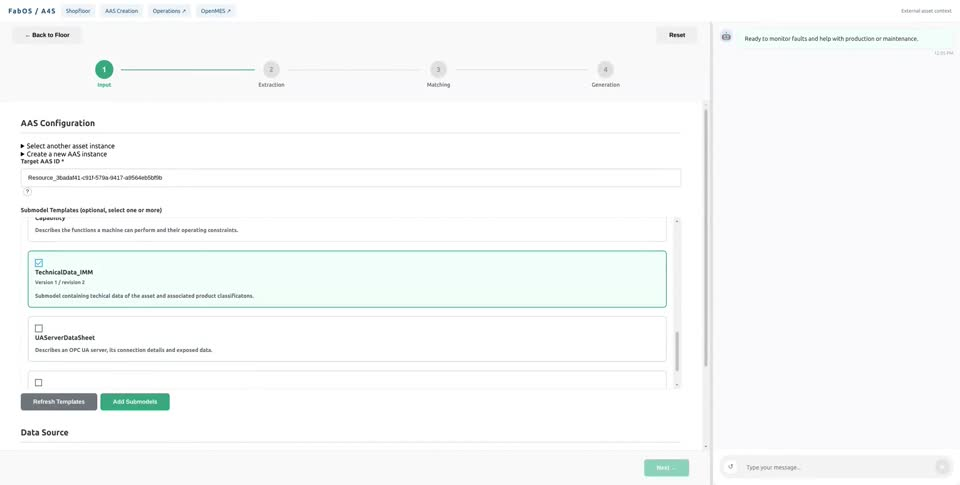
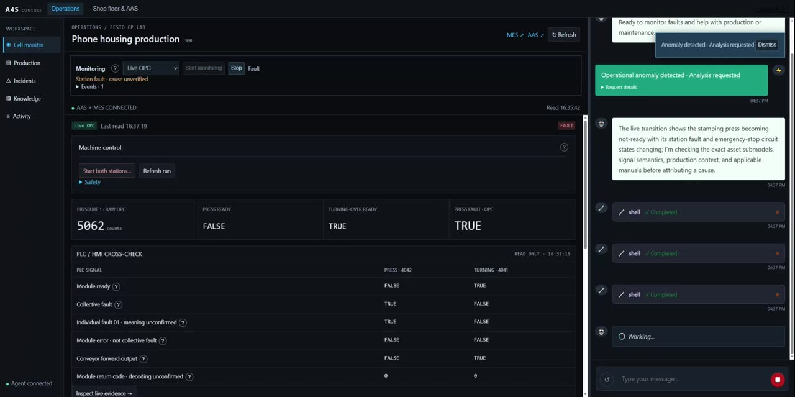

# A4S Harness

A4S is an agentic active AAS harness for connecting an AI agent to industrial
assets and business systems through explicit, reviewable interfaces. The AAS
describes assets, capabilities and bindings; OPC UA supplies live signals and
accepts configured operations; a MES adapter provides production and
maintenance context. The harness coordinates these systems, records its work,
and gates consequential actions through policy and approval.

The repository includes a web interface, command line tools, AAS discovery and
editing, OPC UA clients, MES integration points, and an Operations view with a
local simulation for trying the workflow without connecting equipment.

If you use this work in your research, please [cite the A4S paper](#citation).

## Use cases

### AAS Creation for machine integration

Discover an asset, create its AAS from a blueprint, and enrich it with structured
information extracted from documents. The AAS keeps machine data and interface
bindings available to connected applications and agents.

Create and Edit share a standardized-template checklist. Existing submodel data
can be matched alongside new input, with reviewed replacements and revision history. See
[Updating an existing AAS](docs/aas-instance-updates.md) for the local workflow,
recovery, and the maintained local BaSyx environment.

[IDTA template catalog](docs/idta-template-catalog.md) records the
latest published-template downloads, strict SDK/SML checks, backups, exclusions
and the completed CLI verification. The promoted local configuration and
blueprints are under [BaSyxMinimal](BaSyxMinimal/README.md).

The template checklist supports keyword and version filtering and a selected-only
view; changing filters keeps your selections. Shopfloor discovers blueprint IDs
from the library, including newly imported device types. See
[library discovery and instance creation](docs/blueprint-library.md) for repository
configuration and the distinction between source blueprints and device targets.

[](docs/videos/aas-creation-machine-integration.mp4)

[▶ Watch the AAS Creation demo (2:39)](docs/videos/aas-creation-machine-integration.mp4)

### Agentic Shopfloor Management

An agent combines live OPC UA observations with AAS and MES context to
investigate a shopfloor event, explain its evidence, and prepare a reviewed
maintenance and production response.

[](docs/videos/agentic-shopfloor-management.mp4)

[▶ Watch the Agentic Shopfloor Management demo (1:55)](docs/videos/agentic-shopfloor-management.mp4)

## Start locally

See [the tutorial](docs/tutorial.md) for setup. In brief, install the Python
package and frontend dependencies, configure the local services, then run
`start.cmd` on Windows. The Operations page can use its built-in simulation;
no physical OPC UA server is needed to explore that workflow.

## Required AAS dependency versions

The local AAS Creation and reviewed-update workflow requires the following
tested versions, verified against the running environment on 2026-10-22.
Treat these as compatibility requirements; changing a version requires repeating
the template import, parse, instantiate and reviewed-update checks.

| Dependency | Required version |
| --- | --- |
| Python | `>=3.11,<3.15` (local verification: `3.14.0`) |
| BaSyx Python SDK | `basyx-python-sdk==2.2.0` |
| BaSyx AAS Environment | `2.0.0-milestone-15` |
| BaSyx AAS Registry | `2.0.0-SNAPSHOT`, locked to the tested image digest |
| BaSyx Submodel Registry | `2.0.0-SNAPSHOT`, locked to the tested image digest |
| BaSyx AAS Discovery | `2.0.0-SNAPSHOT`, locked to the tested image digest |
| BaSyx AAS Web UI | `SNAPSHOT`, locked to the tested image digest |
| MongoDB | `7.0.16` |
| Eclipse Mosquitto | `2.0.15` |

The SDK is pinned in both the `aas` and `ui` extras in `pyproject.toml`;
installing only the core CLI does not install it. For the AAS web workflow:

```powershell
.venv/Scripts/python.exe -m pip install -e ".[ui,aas]"
```

Docker images, including the mutable SNAPSHOT tags, are pinned by digest in
`BaSyxMinimal/docker-compose.yml`. Exact image references and verification
commands are in [the BaSyx README](BaSyxMinimal/README.md#required-versions).

The bundled IDTA catalog is a tested, curated import: 64 of 67 upstream template
models passed strict SDK parsing, 63 unique templates were included, and 201
compatibility adjustments were recorded in the generated catalog. The original
downloads are preserved unchanged. See [the import results and limitations](docs/idta-template-catalog.md#source-selection-and-results);
upgrading the SDK alone does not establish that every upstream template is valid.

## Connect an OPC UA server

Copy an AAS blueprint to a local JSON file and set the endpoint and node IDs in
its interface bindings. For readable properties, use a `valueSource` qualifier;
for callable operations, use an `invocationDelegation` qualifier. The format is
`opc.tcp://HOST:PORT#NODE_ID`, for example:

```json
{
  "type": "valueSource",
  "value": "opc.tcp://opc.example.org:4840#ns=2;s=Line1.Temperature"
}
```

Use the OPC UA Browse command or your server's address-space browser to get the
node IDs, then edit the copied blueprint and import it into your AAS repository.
Keep server addresses and credentials in your local configuration. See
[OPC UA connection setup](docs/opc-connection.md) for details and an operation
example.

## Project map

- `a4s/`: agent runtime, AAS and OPC UA clients, MES adapters, server API
- `frontend/`: web interface, including Operations and simulation
- `BaSyxMinimal/`: local AAS repository configuration and example blueprints
- `docs/`: setup, interface configuration, and repository layout
- `tests/`: automated checks

## Security and scope

Do not commit local `.env` files, access tokens, certificates, server addresses,
or exported production data. Use example hostnames in shared blueprints and put
deployment-specific values in local configuration. Simulation demonstrates
software behavior only; it does not validate or authorize physical equipment
actions.

## Citation

If you use A4S Harness or build on its approach in your research, please cite:

Li, J., Ruan, Q., Shi, D., Schneider, M., Meyer, O., Oberle, M., Yi, L., & Tao, F.
(2026). **Agentic active Asset Administration Shell for circular manufacturing.**
*Journal of Manufacturing Systems, 88*, 858–886.
[Paper](https://www.sciencedirect.com/science/article/pii/S0278612526001950) ·
[DOI: 10.1016/j.jmsy.2026.07.011](https://doi.org/10.1016/j.jmsy.2026.07.011)

```bibtex
@article{li2026agentic,
  title   = {Agentic active {Asset Administration Shell} for circular manufacturing},
  author  = {Li, Jianzhang and Ruan, Qian and Shi, Dachuan and Schneider, Matthias
             and Meyer, Olga and Oberle, Michael and Yi, Li and Tao, Fei},
  journal = {Journal of Manufacturing Systems},
  volume  = {88},
  pages   = {858--886},
  year    = {2026},
  doi     = {10.1016/j.jmsy.2026.07.011},
  url     = {https://www.sciencedirect.com/science/article/pii/S0278612526001950}
}
```

GitHub's **Cite this repository** menu uses [CITATION.cff](CITATION.cff),
which identifies this paper as the preferred citation.

## License

**Non-commercial research use only. Commercial use is prohibited.**

Original contributions controlled by the project licensors are offered under
the [Dachuan Shi Non-Commercial Research License 1.0](LICENSE)
(`LicenseRef-Dachuan-Shi-NC-1.0`). This includes a prohibition on commercial products,
paid services, customer projects, internal business use, commercial R&D and
commercial model training. A separate prior written authorization is required
for commercial use; this license grants none.

Third-party software, assets, datasets and previously granted rights retain
their applicable terms. See the repository's `LICENSING.md` for scope and
licensing history. This is source-available software, not OSI-approved
open-source software.
